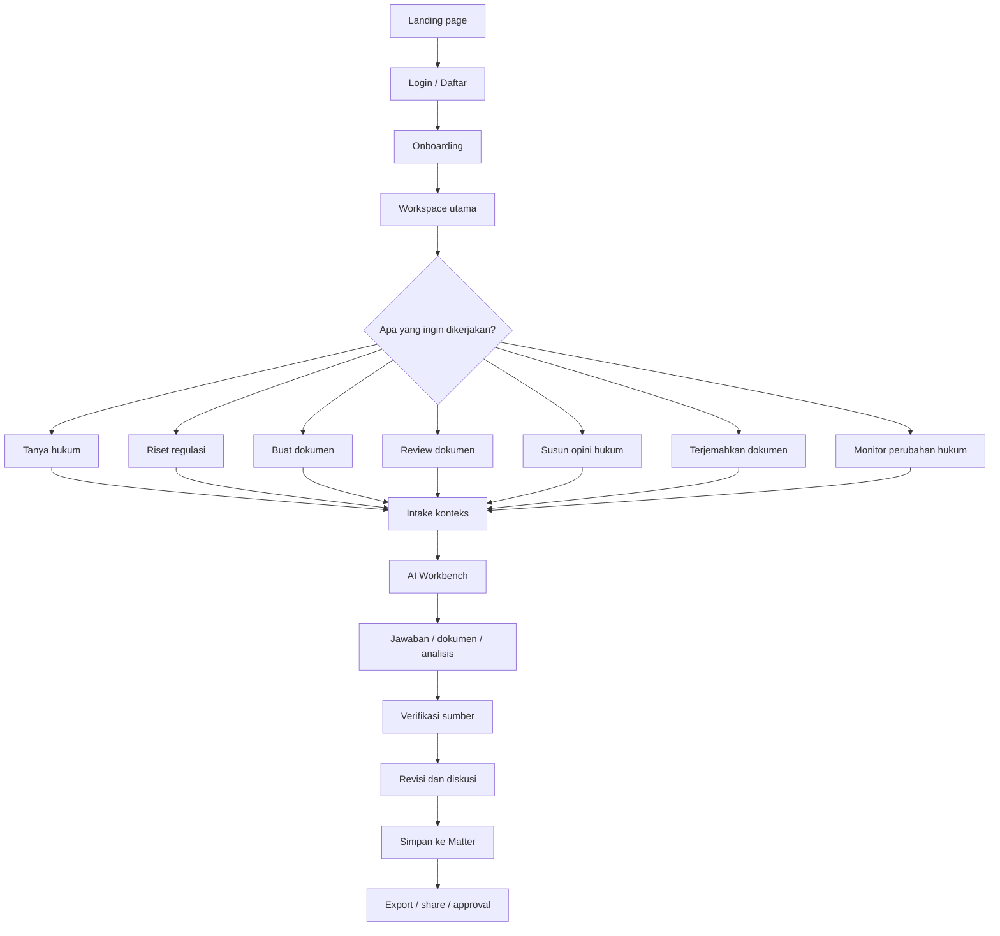

# Workflow Produk Legatia

## Tujuan

Workflow Legatia menggabungkan:

- Riset hukum mendalam dan kontrol sumber seperti Astra for Law.
- Task launcher, workspace, dan monitoring seperti Veritask.
- Chat sederhana serta alur opini hukum IRAC seperti Klaussa.

Prinsip utamanya: satu workspace berbasis **Matter**, satu task launcher, satu AI Workbench, dan setiap klaim hukum memiliki sumber yang dapat diverifikasi.

## Workflow Utama



## 1. Landing Page

Halaman awal harus langsung menawarkan jalur kerja:

- Mulai riset
- Buat dokumen
- Review kontrak
- Susun opini hukum
- Cek regulasi terbaru
- Coba gratis
- Jadwalkan demo enterprise

Struktur halaman:

1. Value proposition.
2. Contoh pertanyaan hukum.
3. Contoh output dengan sitasi.
4. Daftar use case.
5. Keamanan dan privasi.
6. Harga.
7. CTA login atau mulai trial.

## 2. Login dan Onboarding

### Login

- Google.
- Email dan password.
- SSO untuk perusahaan.
- MFA untuk akun profesional.

### Onboarding

Onboarding dibuat singkat dalam tiga langkah.

#### Langkah 1 — Tipe pengguna

- Mahasiswa.
- Lawyer.
- Legal officer.
- Compliance.
- Founder atau bisnis.

#### Langkah 2 — Kebutuhan utama

- Riset hukum.
- Drafting.
- Review kontrak.
- Litigasi.
- Compliance.
- Corporate.

#### Langkah 3 — Preferensi workspace

- Bahasa Indonesia atau Inggris.
- Yurisdiksi.
- Gaya sitasi.
- Tingkat kedalaman jawaban.

Setelah onboarding selesai, pengguna langsung masuk ke workspace.

## 3. Workspace Utama

Pertanyaan utama di halaman ini:

> Apa yang ingin Anda kerjakan hari ini?

### Task cards

- Tanya hukum.
- Cari peraturan.
- Cari putusan.
- Buat dokumen.
- Review dokumen.
- Susun opini hukum.
- Terjemahkan dokumen.
- Monitor regulasi.

### Komponen tambahan

- Matter terakhir.
- Draft terakhir.
- Perubahan regulasi yang relevan.
- Riwayat pekerjaan.
- Bookmark sumber.
- Pekerjaan yang menunggu review.

### Navigasi utama

- Home.
- Matters.
- Research.
- Documents.
- Monitoring.
- Templates.
- Team.
- Settings.

Chat tetap menjadi pintu masuk utama, sedangkan pekerjaan kompleks berpindah ke workflow khusus.

## 4. Matter sebagai Pusat Pekerjaan

Setiap pekerjaan berada dalam sebuah **Matter**.

Contoh Matter:

- PHK karyawan PT ABC.
- Due diligence akuisisi PT XYZ.
- Penyusunan NDA vendor.

Satu Matter menyimpan:

- Pertanyaan.
- Dokumen.
- Hasil riset.
- Sitasi.
- Draft.
- Opini.
- Komentar tim.
- Versi dokumen.
- Audit trail.

Matter menjaga konteks saat pengguna berpindah dari riset ke drafting atau review.

## 5. Intake Sebelum AI Bekerja

Legatia mengumpulkan konteks secara bertahap sebelum menghasilkan output.

### Riset

- Pertanyaan hukum.
- Fakta utama.
- Yurisdiksi.
- Tanggal relevansi.
- Jenis sumber yang diinginkan.
- Tingkat kedalaman: cepat, standar, atau mendalam.

### Drafting

- Jenis dokumen.
- Para pihak.
- Tujuan dokumen.
- Posisi pengguna.
- Klausul wajib.
- Regulasi yang harus digunakan.
- Tingkat perlindungan: seimbang, protektif, atau sangat protektif.

### Review

- Upload dokumen.
- Posisi pihak pengguna.
- Jenis risiko yang dicari.
- Regulasi pembanding.
- Output: ringkasan, tabel risiko, redline, atau memo.

### Opini hukum

Gunakan format IRAC:

1. Issue.
2. Rule.
3. Analysis.
4. Conclusion.

Pilihan postur opini:

- Tentatif.
- Pendapat hukum standar.
- Definitif.

## 6. AI Workbench

AI Workbench adalah ruang utama untuk membaca konteks, menghasilkan output, dan memeriksa sumber.

```text
┌─────────────────────────────────────────────┐
│ Header: Matter | Status | Save | Export     │
├──────────────┬────────────────┬─────────────┤
│ Dokumen &    │ Jawaban /      │ Sumber &    │
│ konteks      │ draft AI       │ audit trail │
│              │                │             │
│ - Facts      │                │ - Pasal     │
│ - Files      │                │ - Status    │
│ - Tasks      │                │ - Kutipan   │
│ - Versions   │                │ - Confidence│
├──────────────┴────────────────┴─────────────┤
│ Follow-up / revisi / instruksi berikutnya   │
└─────────────────────────────────────────────┘
```

### Panel kiri

- Fakta perkara.
- Dokumen yang diunggah.
- Riwayat versi.
- Instruksi pengguna.
- Scope regulasi.

### Panel tengah

- Jawaban riset.
- Draft kontrak.
- Memo opini.
- Hasil review.
- Tabel risiko.
- Redline.

### Panel kanan

- Sitasi per klaim.
- Status regulasi: berlaku, diubah, atau dicabut.
- Sumber asli.
- Confidence level.
- Bagian yang belum pasti.
- Perkara yang melemahkan argumen.

## 7. Aturan Jawaban Hukum

Setiap output harus memiliki:

- Dasar hukum.
- Tautan ke sumber.
- Tanggal sumber.
- Status keberlakuan.
- Tingkat keyakinan.
- Fakta yang digunakan.
- Asumsi yang dibuat.
- Bagian yang membutuhkan verifikasi lawyer.

Jika sumber tidak ditemukan, Legatia harus menyatakan:

> Belum ditemukan dasar hukum yang cukup untuk mendukung kesimpulan ini.

Legatia tidak boleh mengisi kekosongan dengan pasal yang dibuat-buat.

## 8. Alur Per Fitur

### Tanya hukum

```text
Pertanyaan
  → AI mencari sumber
  → jawaban terstruktur
  → sitasi per klaim
  → follow-up
  → simpan ke Matter
```

### Riset regulasi

```text
Topik / nomor aturan
  → filter jenis, tahun, lembaga, status
  → hasil pencarian
  → buka naskah asli
  → lihat hubungan perubahan
  → bookmark atau masukkan ke Matter
```

### Drafting

```text
Pilih tipe dokumen
  → isi pihak dan tujuan
  → pilih template atau mulai kosong
  → AI membuat draft
  → cek sitasi dan klausul
  → revisi
  → export Word/PDF
```

### Review kontrak

```text
Upload dokumen
  → pilih posisi pihak
  → AI mengekstrak klausul
  → klasifikasi risiko
  → tampilkan tabel risiko
  → redline atau komentar
  → approval lawyer
```

### Legal opinion

```text
Konteks
  → fakta dan pertanyaan
  → pilih postur opini
  → AI menyusun IRAC
  → sumber pendukung dan sumber berlawanan
  → review
  → export memo
```

### Compliance monitoring

```text
Pilih sektor dan regulasi
  → Legatia memantau perubahan
  → perubahan dikirim ke dashboard
  → AI menganalisis dampak
  → buat compliance task
  → assign ke anggota tim
  → tandai selesai
```

## 9. Output dan Kolaborasi

Setiap hasil memiliki aksi:

- Simpan.
- Buat versi baru.
- Minta revisi.
- Tambahkan komentar.
- Share ke tim.
- Export Word.
- Export PDF.
- Copy citation.
- Tandai sudah diverifikasi.

### Role tim

- Owner.
- Reviewer.
- Approver.
- Viewer.

Audit trail mencatat siapa yang membuka, mengubah, menyetujui, atau mengekspor dokumen.

## 10. Workflow Enterprise

```text
Request demo
  → discovery kebutuhan
  → setup workspace
  → migrasi dokumen
  → konfigurasi role dan ethical wall
  → training
  → pilot Matter
  → rollout
  → monitoring penggunaan
```

Fitur enterprise:

- SSO.
- MFA.
- RBAC.
- Ethical wall.
- Data retention policy.
- Audit log.
- Private knowledge base.
- Connector ke document management system.
- Matter-level permissions.

## Prioritas Pembangunan

### MVP

1. Login dan onboarding singkat.
2. Workspace utama.
3. Tanya hukum dengan sitasi.
4. Cari regulasi.
5. Matter.
6. Upload dan review dokumen dasar.
7. Export hasil.

### Fase Kedua

1. Drafting.
2. Legal opinion IRAC.
3. Putusan pengadilan.
4. Status perubahan regulasi.
5. Bookmark dan riwayat.
6. Komentar dan kolaborasi.

### Fase Ketiga

1. Compliance monitoring.
2. Redline otomatis.
3. Knowledge base firma.
4. SSO dan ethical wall.
5. Integrasi Word dan document management.
6. API dan plugin.

## Ringkasan

Legatia sebaiknya menjadi platform dengan:

1. Satu workspace berbasis Matter.
2. Satu task launcher untuk semua pekerjaan hukum.
3. Satu AI Workbench untuk riset, drafting, review, dan opini.
4. Sitasi wajib pada setiap klaim hukum.
5. Verifikasi status regulasi secara otomatis.
6. Kolaborasi dan approval untuk tim.
7. Guardrail yang jelas ketika sumber tidak cukup.
